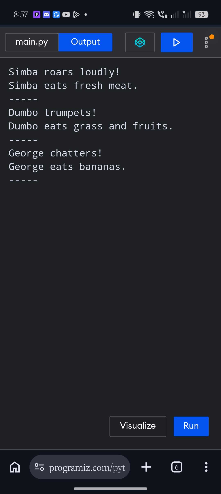

# Overview of the code

The Zoo Management System program simulates animals in a zoo. The system models a general parent class(Animal) and three specific child classes, which are: Lion, Elephant, and Monkey, and each animal type performs two core actions: making a sound and eating.

# Test Run/output:

